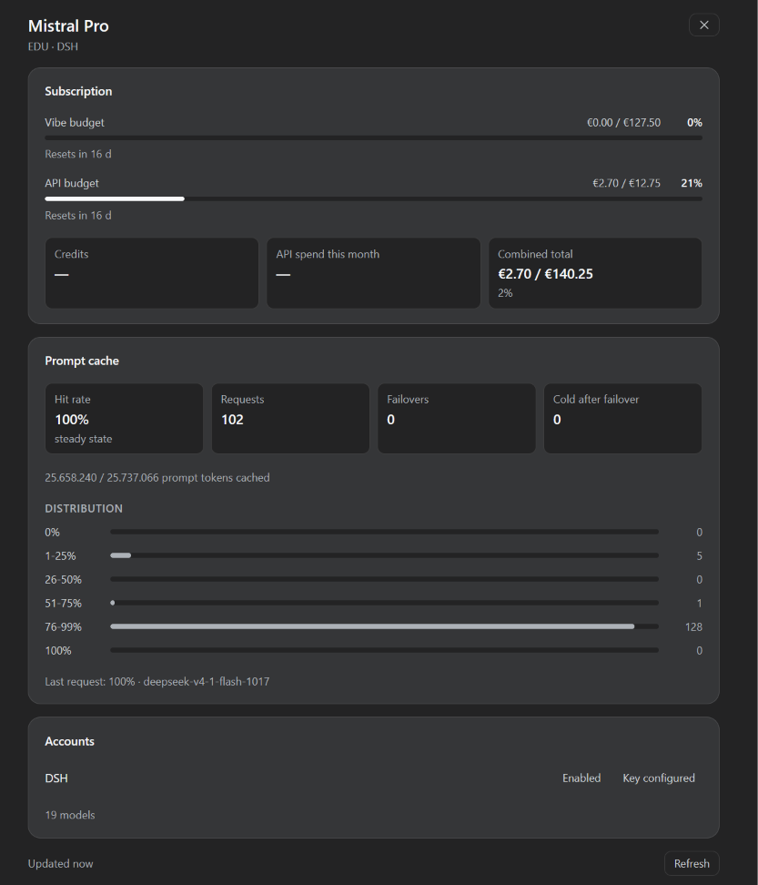

### dsh-mistral-pro

DeepSeek Harness で Mistral のサブスクリプション（Vibe Pro / Team）を利用するためのプラグインです。`mistral-pro` モデルルート、複数アカウントのフェイルオーバー、プロンプトキャッシュのチューニング、入力欄ツールバーの使用量ポップオーバーを提供します。

   

[English](README.md) · [中文](README.zh.md) · [日本語](README.ja.md)

---



> **これはフォークです。** [`lordraiden/dsh-mistral-pro`](https://github.com/lordraiden/dsh-mistral-pro) は、上流 `0.1.2` の上に存在した 2 つの独立した修正ライン[`santera-pixel/dsh-mistral-pro`](https://github.com/santera-pixel/dsh-mistral-pro)（0.2.0–0.2.4）と[上流 issue #1 のパッチシリーズ](https://github.com/01NGVI-QINGYI/dsh-mistral-pro/issues/1)（0.1.3–0.1.8）を統合したものです。統合の全容は [CHANGELOG.md](CHANGELOG.md) を参照してください。

> 英語版 [README.md](README.md) が正式版です。本翻訳より新しい場合があります。

## 0.3.0 での変更

- **ツール呼び出しが `unknown tool ""` として届かなくなりました。** Mistral はストリーミングのツール呼び出しで、継続チャンクごとに `function.name: ""` を繰り返します。アキュムレータは空でない名前だけを受け取り、最初に見た名前を保持するようになりました。
- **`block-start` はブロックごとに 1 回だけ** になったため、ストリーミング中に思考パネルが折りたたまれなくなりました。
- **`tool-call-delta` の `id` は常に文字列** です。これは harness のストリーム契約で要求されています。
- **リトライポリシーは解決済みのフラットな形** になったため、最初の一時的な失敗で `session event "llm/retry" carries non-JSON-serializable data` になることはなくなりました。
- **途中で切れたストリームは `TRANSPORT` を送出** し、部分的な出力のまま「成功」でターンを終えることはなくなりました。
- **`max_tokens` の上限を注入しません**（`advanced.maxTokensCap` の既定値は `0`）。推論は補完予算を共有するため、テキストには余裕に見える上限でも思考だけで使い切ることがあります。
- **ツール呼び出し時に試行状態を確定** します。ツール呼び出し後のストリーム途中の失敗でアカウントのフェイルオーバーが起き、2 つのアカウントの出力が 1 ターンに混ざることはなくなりました。
- **プロンプトキャッシュのチューニング**: `advanced.promptCacheKey` が `auto`、`shared`、`off`、または任意の文字列をサポートし、`/wire` が各リクエストで実際に返された `cached_tokens` を記録します。

## インストール

動作環境: DSH `>= 0.2.1-rc.5`、Node `^22.19.0 || >=24.0.0`

コミットに固定したフォークをインストールします:

```sh
dsh plugin --profile web add github:lordraiden/dsh-mistral-pro#8942e9ca453b19c65fd49178b7685c9d18f1b8a2
```

または profile の `package.json` に追加してからインストールします:

```json
{
  "dependencies": {
    "dsh-mistral-pro": "github:lordraiden/dsh-mistral-pro#8942e9ca453b19c65fd49178b7685c9d18f1b8a2"
  }
}
```

```sh
pnpm install
```

ローカルのチェックアウトからは、tarball にパッケージ化する方法（推奨）か、ディレクトリを直接リンクする方法があります:

```sh
npm pack
dsh plugin --profile web add /absolute/path/to/dsh-mistral-pro-0.4.0.tgz
```

ディレクトリ指定ではシンボリックリンクが作成されます。pnpm はリンク先の `peerDependencies` を解決しないため、リポジトリ内には現在の profile の共有依存を参照する `node_modules/@deepseek-ai/*` のリンクを同梱しています（tarball には含まれません）。

インストール後、**Plugins** ページで `dsh-mistral-pro` を有効化して再読み込みしてください。インストール済みのバージョンを変更した後はホストの再起動が必要です。

## アカウントの登録

**Settings → Mistral Pro → Accounts** を開きます。

1. **Add account** をクリックし、表示用のアカウント名を入力します（表示と並び順のみに使用されます）。
2. **Credential reference** に `MISTRAL_API_KEY` などの環境変数名を指定します。
3. パスワード欄に API キーを貼り付けて **Set key** を押します。キーは DSH のクレデンシャルストアに保存され、ブラウザ側には再表示されません。
4. **Test** を押すと `/v1/models` にリクエストを送り、疎通を確認します。

API キーは [Code › Vibe CLI](https://chat.mistral.ai/code/extensions) から発行できます。同じキーで無料枠・有料プラン・従量課金のすべてに対応しており、リクエスト時はプランの月次枠から優先的に消費され、超過分が従量課金になります。

複数アカウントを登録した場合はリストの上から順に使用されます（↑ / ↓ で並び替え可能）。最上位の有効なアカウントがメインとなり、エラーで別アカウントへ切り替わった場合はプロセス終了までメモリ上で優先順位が入れ替わります（設定ファイル自体は書き換わりません）。

## モデル管理

**Settings → Mistral Pro → Models** には、内蔵カタログと `/v1/models` から取得したモデルが一覧表示されます。**Visible** のチェックを外すとモデル選択リストから非表示になります。コンテキスト長・最大出力トークン数・**Default effort**（リクエスト時の `reasoning_effort`）はモデル単位で変更できます。

内蔵カタログ（2026-11 時点、全 19 件・既定で 11 件表示）。キーがある場合は `/v1/models` を優先し、同じモデルの別名は 1 件にまとめます:

| モデル | コンテキスト | 推論強度 |
| --- | --- | --- |
| `mistral-large-4` | 1M | low / medium / high |
| `mistral-small-2603` | 256K | none / low / medium / high |
| `mistral-medium-3-5` | 128K | none / low / medium / high |
| `zai-glm-5-3` | 1M | low / high / max |
| `zai-glm-5-3-flash` | 1M | low / high / max |
| `deepseek-v4-1-flash-1017` | 1M | none / low / high / max |
| `ministral-3-{14b,8b,3b}-25-12` | 256K | — |
| `codestral-25-08` / `codestral-latest` | 256K | — |

`mistral-large-2512`、`devstral-2512`、`mistral-medium-2508` は初期状態で非表示になっており、必要に応じて一覧から有効化できます。

## 使用量ポップオーバー

入力欄ツールバーに `● Mistral` ボタンが追加され、クリックすると以下の情報を確認できます。

- 各使用枠の消化率、使用量 / 上限、リセットまでの残り時間
- プリペイド残高と当月の API 利用額
- 手動更新ボタンと最終更新時刻

ツールバー上のボタンには、`Vibe`・`monthly`・`plan` を含むラベルを優先して最初に見つかった使用枠が表示されます。タブがバックグラウンドにある間はポーリングを一時停止し、フォアグラウンドに戻ると即座に更新します。

使用量は `api.mistral.ai/v1/billing/budget` から、保存した API キーで直接取得します。追加設定は不要です。Vibe と API の月次予算（使用率、予算額、リセット日時）が返ります。

このキーに usage 権限がない場合（請求エンドポイントが 403 を返す場合）は、管理サイトの Cookie でも取得できます。

1. [Mistral Admin](https://admin.mistral.ai/organization/usage) にログインします。
2. ブラウザの DevTools → Network を開き、`admin.mistral.ai` 宛ての任意のリクエストから `Cookie` ヘッダー全体をコピーします（`ory_session_*` が必須です。`csrftoken` が含まれている場合は `X-CSRFTOKEN` ヘッダーも自動付与されます）。
3. **Settings → Mistral Pro → Advanced** に貼り付け、**Set cookie** を押します。

Cookie を使う場合は `GET /subscription`、`GET /api/billing/v2/usage?month=&year=`、`GET /api/billing/credits` の 3 つのエンドポイントを個別に呼び出します。一部が失敗しても他の項目はそのまま表示されます。セッション切れでログイン画面へリダイレクトされた場合は、Cookie の再設定を促すメッセージが表示されます。

## リクエスト処理とフェイルオーバー

`llm` サービスから渡されたメッセージはアダプター側で OpenAI 互換形式に変換され、`https://api.mistral.ai/v1/chat/completions` へ POST されます。返却された SSE ストリームを 1 行ずつパースし、DSH の `StreamChunk` として出力します。過去の assistant メッセージに含まれる reasoning は、Mistral API の仕様に合わせて `thinking` チャンクとして再送されます。

アカウントのフェイルオーバーは、ストリームの出力が始まる前にのみ行われます。

- 401 / 403、429、上限到達、キーの未設定・形式不正が発生した場合は次のアカウントへ切り替え、失敗したアカウントはメモリ上で 300 秒間クールダウンに入ります。
- テキスト・推論・ツール呼び出しのいずれかがすでに出力された後は、複数アカウントの応答が混ざるのを防ぐため切り替えを行わず、そのままエラーを返します。

## プロンプトキャッシュ

Mistral の[プロンプトキャッシュ](https://docs.mistral.ai/inference/conversations/advanced/prompt-caching)は、リクエストが同じ**プレフィックス**を共有するときに、計算済みのプロンプトトークンを再利用します。キャッシュされたトークンは通常の入力価格の 10% で課金され、`usage.prompt_tokens_details.cached_tokens` で報告されます。

このプラグインのすべての判断は、ドキュメントの次の 2 つの事実に基づいています:

- `prompt_cache_key` は**ルーティングのヒント**です。「キャッシュヒットの可能性を高めるが、保証はしない」——ヒットするかどうかは、API が互換性のあるキャッシュ済みプレフィックスを見つけられるかで決まります。キーがキャッシュを作るのではなく、プレフィックスの安定性が作ります。
- キャッシュブロックは **64 トークン**です。`cached_tokens` は常に 64 の倍数で、64 トークン未満のプロンプトは決してヒットしません。共有プレフィックスが長いほど、より多く再利用されます。

プラグインがプレフィックスを安定させるために行っていること:

- リクエストに揮発性の内容（タイムスタンプ、セッション ID、カウンター）を一切注入しません。
- メッセージの順序を保ち、assistant の推論を `thinking` ブロックとして再送するため、プレフィックスはターン間でバイト単位で同一に保たれます。
- ロールごとに非 wire キーを決定的に削除する（`sanitizeMessage`）ため、外部のフィールドがあるターンだけプレフィックスを変えることはありません。
- `stream_options.include_usage` を送信します。これがないと `cached_tokens` はそもそも報告されません。

`advanced.promptCacheKey` でキーを選択します:

| 値 | キーの導出 | 適した用途 |
| --- | --- | --- |
| `auto`（既定） | モデル + システムプロンプト + 最初のユーザーメッセージ | 1 つの長い会話: ターンを追記しても同じキーを保ちます。 |
| `shared` | モデル + システムプロンプトのみ | 同じ（大きな）システムプロンプトを再利用する多数の短い会話: 新しい会話の最初のターンでも、キャッシュ済みのシステムプロンプトのプレフィックスにヒットできます。 |
| `off` | フィールドを送信しない | このフィールドを拒否するプロバイダーやプロキシ。 |
| その他の文字列 | そのまま送信 | キーを外部で管理する場合（ワークフロー、チーム、サブスクリプションごとなど）。 |

`auto` と `shared` は優劣ではなくトレードオフです。`auto` は会話を分離し、Mistral の推奨（「会話 ID のような安定したアプリケーションレベルの識別子を使う」）に沿います。`shared` はその分離を犠牲にして、別々の会話がシステムプロンプトを再利用できるようにします。プロバイダーはプレフィックスの互換性を検証するため、共有キーはミスするだけで、他の会話の内容を返すことはありません。

プラグインは同じ値を `x-affinity` ヘッダーとしても送信し、1 つの会話のターンが同じサーバーに届くようにします。`cache.affinity` と `cache.reportUsage` は個別に無効化できます。`reportUsage` を無効にすると、キャッシュヒットの数値も失います。

実際に何が起きたかを確認するには、`GET /plugins/dsh-mistral-pro/wire?limit=20` を使います。各リクエストの `usage` エントリに `promptTokens` と `cachedTokens` が含まれます。プレフィックスが安定しているのにヒット率がほぼ 0% の場合、プロンプトが 64 トークン未満であるか、ターン間でキャッシュが期限切れになったか、上流で最初のメッセージが書き換えられているかのいずれかです。

## 設定項目

- **Accounts**: アカウントの追加・削除、並び替え、有効/無効、API キーの保存（保存して有効化）、疎通テスト
- **Models**: 表示切り替え、コンテキスト長、最大出力トークン数、既定の推論強度
- **Advanced**: 自動フェイルオーバー、クールダウン、タイムアウト、カタログ更新、出力上限、プロンプトキャッシュキー、トランスポート、プロキシ、ボタンの表示モード、更新間隔、任意の Cookie フォールバック


設定の変更はすべて即座に反映され、プラグインの再起動は不要です。

## 診断用ルート

状態確認やトラブルシューティング用に、同一オリジンの読み取り専用ルートを提供しています。

| ルート | 内容 |
| --- | --- |
| `/plugins/dsh-mistral-pro/health` | アカウント設定の有無、登録済み provider、モデル数 |
| `/plugins/dsh-mistral-pro/meta` | 現在有効な usage / advanced / accounts 設定 |
| `/plugins/dsh-mistral-pro/models` | モデルカタログ、表示状態、上限値、推論設定 |
| `/plugins/dsh-mistral-pro/usage?account=&force=1` | 集約された使用量スナップショット |
| `/plugins/dsh-mistral-pro/test?account=` | 指定アカウントでの `/v1/models` 疎通確認 |
| `/plugins/dsh-mistral-pro/refresh` | モデルカタログの即時更新 |
| `/plugins/dsh-mistral-pro/settings` | 設定の名前空間と revision |
| `/plugins/dsh-mistral-pro/wire?limit=20` | 最新の wire フィンガープリント、メッセージごとのキー構成、キャッシュ使用量 |

## トランスポートと wire ログ

チャットリクエストは `globalThis.fetch` を経由せず、アダプターがすでにシリアライズしたボディをそのまま `node:https` で送信します。

プロキシ系プラグインは `globalThis.fetch` を置き換え、送信時にリクエストボディを再シリアライズします。たとえば billion-context の ACP ループは、モデル ID が `/deepseek/i` に一致する場合、ツール呼び出しを含むすべての assistant メッセージに `reasoning_content: ""` を追加します。`deepseek-v4-1-flash-1017` はこれに一致します。Mistral は assistant メッセージ上のこのフィールドを禁止しているため、書き換えが入ると最初のツール呼び出し以降のすべてのターンが `422 extra_forbidden` になります。`node:https` は同じプロセス内の別プラグインからは差し替えられないため、アダプターが構築したバイト列がそのままマシンから出ていきます。

- `DSH_MISTRAL_TRANSPORT=fetch` で従来のパスに戻ります。ボディを書き換えるラッパーがない場合にのみ使用してください。
- `advanced.proxy` を設定した場合は常に fetch + undici の `ProxyAgent` を使います。このパスには dispatcher が必要だからです。
- トレードオフ: この経路で送った通信は、プロキシ系プラグインの圧縮や書き換えを通りません。正確さを優先します。

リクエストごとに `%TEMP%\dsh-mistral-wire.log` へ 1 行追記します（`DSH_MISTRAL_WIRE_LOG` で変更可能）: モデル ID、メッセージ数、各メッセージの role とキー、`reasoning_content` を持つメッセージ数、シリアライズしたボディの 16 桁の SHA-256 です。2 行目の `usage` 行には `promptTokens` と `cachedTokens` が記録されます。ログは 400 行に切り詰められ、ログ出力の失敗がリクエストを中断することはありません。

## データとプライバシー

- チャット内容は設定した Mistral エンドポイントにのみ送信されます。
- モデルカタログの取得時は API キーと `User-Agent` のみを送信し、会話内容は一切含みません。
- 使用量の取得は `admin.mistral.ai`（変更可）に対してのみ行われ、登録した Cookie が使用されます。
- API キーと Cookie はホスト側のクレデンシャルストアに保管され、ブラウザ側には「設定済みかどうか」のみが返されます。

## 制限事項

- `/v1/billing/budget` と管理サイトの使用量 API は非公開仕様です。フィールド名で読み取っているため、上流の構造変更で一部の枠が表示されないことがあります。
- `prompt_cache_key` はヒントであり保証ではありません。プレフィックスが安定していても、プロバイダーのキャッシュが期限切れになればミスしますし、64 トークン未満のプロンプトは決してヒットしません。
- フェイルオーバーによるアカウント順位の繰り上げはメモリ上でのみ保持され、プロセス再起動時には設定順に戻ります。
- 画像入力には DSH の `attachments` サービスが必要です。利用できない環境ではプレースホルダー文字列に置き換わります。
- プロキシ機能はホスト環境で `undici` を解決できる必要があります（解決できない場合はエラーを返します）。
- 設定画面の UI 表記は現在英語と中国語のみ対応しており、日本語環境では英語表示にフォールバックします。

## 開発・テスト

```sh
node test/tool-name.mjs   # 取得済みのパートナーモデルのストリーム: ツール名が保持される
node test/merged.mjs      # キャッシュキー、使用量、出力上限、リトライポリシー、wire キー、試行状態
node --check index.js     # client.js と lib/*.js も同様
```

テストは Mistral の SSE ストリームを模したローカルのモック HTTP サーバーに対して実行され、外部ネットワーク通信も API キーも不要です。

## License

MIT · オリジナルは 01NGVI-QINGYI によるもので、フォークは lordraiden が保守しています。
