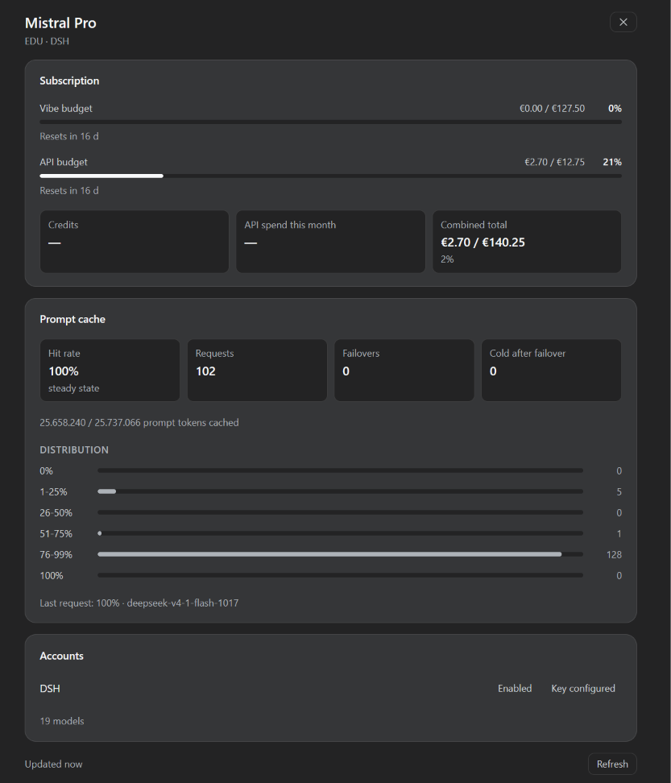
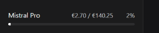
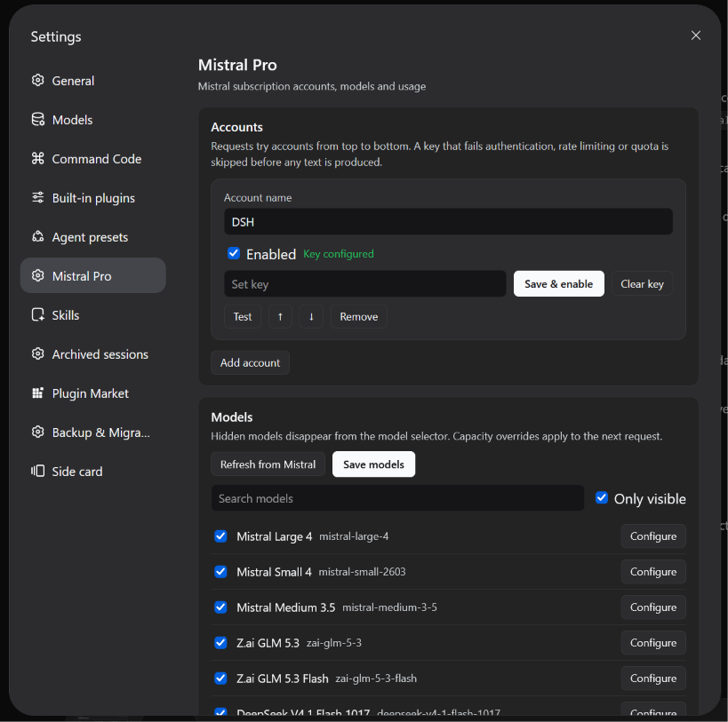

# dsh-mistral-pro

**Mistral subscription (Vibe Pro / Team) provider for [DeepSeek Harness](https://github.com/deepseek-ai/deepseek-harness) (DSH).** Adds the `mistral-pro` model route, multi-account failover, prompt-cache tuning, and a sidebar usage card with a statistics panel.

   

[English](README.md) · [中文](README.zh.md) · [日本語](README.ja.md)



## Contents

- [At a glance](#at-a-glance)
- [Why this plugin](#why-this-plugin)
- [Requirements](#requirements)
- [Installation](#installation)
- [Adding accounts](#adding-accounts)
- [Models](#models)
- [Sidebar usage card and statistics panel](#sidebar-usage-card-and-statistics-panel)
- [Request flow and failover](#request-flow-and-failover)
- [Prompt caching](#prompt-caching)
- [Settings](#settings)
- [Diagnostic routes](#diagnostic-routes)
- [Transport and the wire log](#transport-and-the-wire-log)
- [FAQ](#faq)
- [Data and privacy](#data-and-privacy)
- [Known limitations](#known-limitations)
- [Development](#development)
- [Fork lineage and upstream sync](#fork-lineage-and-upstream-sync)
- [License](#license)

## At a glance

| | |
| --- | --- |
| Model route | `mistral-pro` |
| Model catalog | 19 built-in models (11 visible by default), refreshed from `/v1/models` |
| Failover | Several Mistral accounts, switched before the first streamed output |
| Prompt caching | `auto` / `shared` / `off` cache keys, compaction-aware rotation, hit-rate route |
| UI | Sidebar usage card, statistics panel, Settings → Mistral Pro |
| Transport | Native `node:https`, with an opt-in `fetch` path |

## Why this plugin

- **Mistral models inside DSH.** Registers the `mistral-pro` route with a 19-model catalog (11 visible by default), a live `/v1/models` refresh, and per-model context-window, output and reasoning-effort overrides.
- **Multi-account failover.** Several Mistral keys are tried in order; an account that fails before the first streamed token is skipped and cooled down for 300 seconds.
- **Prompt caching that can actually hit.** Stable prefixes, `auto` / `shared` / `off` cache keys, compaction-aware key rotation, and a route that reports the real `cached_tokens`.
- **Subscription usage at a glance.** Quota windows, reset countdown, prepaid credit and current-month spend in the composer toolbar.
- **Tested and observable.** 11 regression suites, CI on Node 22 and 24, a `0600` wire log, and read-only diagnostic routes.

> **This is a fork.** [`lordraiden/dsh-mistral-pro`](https://github.com/lordraiden/dsh-mistral-pro) merges the two
> independent fix lineages that existed on top of upstream `0.1.2`:
> [`santera-pixel/dsh-mistral-pro`](https://github.com/santera-pixel/dsh-mistral-pro) (0.2.0-0.2.4) and the
> [upstream issue #1 patch series](https://github.com/01NGVI-QINGYI/dsh-mistral-pro/issues/1) (0.1.3-0.1.8).
> See [CHANGELOG.md](CHANGELOG.md) for the full reconciliation and [Fork lineage](#fork-lineage-and-upstream-sync)
> for the version policy.

## Requirements

- DSH `>= 0.2.1-rc.5`
- Node `^22.19.0 || >=24.0.0`
- A Mistral account — Free, Vibe Pro / Team, or pay-as-you-go

## Installation

Install the fork pinned to a release tag:

```sh
dsh plugin --profile web add github:lordraiden/dsh-mistral-pro#v0.4.0
```

Or add it to the profile's `package.json` and install:

```json
{
  "dependencies": {
    "dsh-mistral-pro": "github:lordraiden/dsh-mistral-pro#v0.4.0"
  }
}
```

```sh
pnpm install
```

From a local checkout, pack a tarball (recommended) or link the directory:

```sh
npm pack
dsh plugin --profile web add /absolute/path/to/dsh-mistral-pro-0.4.0.tgz
```

Linking a directory creates a symlink. Because pnpm does not resolve `peerDependencies` for symlinked
targets, the repo includes a `node_modules/@deepseek-ai/*` symlink directory pointing to the active
profile's shared dependencies (excluded when packing the tarball).

Once installed, enable `dsh-mistral-pro` on the **Plugins** page and reload. A host restart is required
after changing the installed version.

## Adding accounts

Open **Settings → Mistral Pro → Accounts**:

1. Click **Add account** and enter a display name (used only for display and ordering).
2. Set **Credential reference** to an environment variable name, such as `MISTRAL_API_KEY`.
3. Paste your API key into the password field and click **Set key**. Keys are stored in the DSH credential
   store and are never sent back to the browser.
4. Click **Test** to run a check against `/v1/models`.

You can generate an API key under [Code › Vibe CLI](https://chat.mistral.ai/code/extensions). The same key
works across Free, subscription plans, and pay-as-you-go; requests consume your monthly plan allowance
first before falling back to pay-as-you-go billing.

Accounts are tried in list order (use ↑ / ↓ to adjust). The first enabled account acts as the primary. When
a failover succeeds, the working account is promoted in memory for the rest of the process lifetime without
modifying your saved config.

### Two keys: Vibe and Studio

For the common setup — a Vibe key with a Studio key behind it — **Settings → Mistral Pro → Keys** has one
row per key:

| Row | Credential reference | Account | Order |
| --- | --- | --- | --- |
| Vibe API key | `MISTRAL_VIBE_KEY` | `Vibe` | primary |
| Studio API key | `MISTRAL_API_KEY` | `Studio` | fallback |

- **Vibe API key** — the key the Vibe CLI uses. After `vibe --setup` it is in `~/.vibe/.env`; you can also
  create one under Code › Extensions → Advanced → Vibe API Key.
- **Studio API key** — a pay-as-you-go key from the Mistral admin: API › API Keys.

Each row has a password field, **Save** and **Test**, and shows whether the key is configured. **Save**
stores the key in the DSH credential store and creates or updates its account (`Vibe` or `Studio`), keeping
Vibe first and Studio second even when other accounts exist. **Test** runs a `/v1/models` check against that
account. The key value is never shown again and never logged.

Requests go to Vibe first. When Vibe answers 402 (budget exhausted) or 429 (rate limit), the adapter fails
over to Studio before the first streamed token, and the failed account cools down for 300 seconds. The
advanced account list stays available for more than two accounts or custom endpoints.

> **Terms of service.** Using the Vibe key outside the official Vibe CLI may not be permitted by Mistral.
> Whether to do it is your decision; the plugin never ships or bundles keys.

### Routing

**Settings → Mistral Pro → Routing** decides which key is tried first and whether a failure falls back:

- **Vibe first** / **Studio first** — the named key is always tried first; a fallback is never promoted.
- **Automatic** — the account that last worked is promoted for the rest of the process.
- **Automatic account failover** — when off, only the first key is used and a failure surfaces instead of
  switching keys.

Changing the priority also reorders the Vibe and Studio accounts, so the account list below never
contradicts it; their reorder arrows are disabled there.

## Models

**Settings → Mistral Pro → Models** combines the built-in catalog with models returned by `/v1/models`.
Uncheck **Visible** to hide a model from the picker. Context window, max output tokens, and **Default
effort** (`reasoning_effort`) can be overridden per model.

Built-in catalog (2026-11, 19 models total, 11 visible by default). With a key, the live `/v1/models`
listing wins and aliases collapse into one entry:

| Model | Context | Reasoning |
| --- | --- | --- |
| `mistral-large-4` | 1M | low / medium / high |
| `mistral-small-2603` | 256K | none / low / medium / high |
| `mistral-medium-3-5` | 128K | none / low / medium / high |
| `zai-glm-5-3` | 1M | low / high / max |
| `zai-glm-5-3-flash` | 1M | low / high / max |
| `deepseek-v4-1-flash-1017` | 1M | none / low / high / max |
| `ministral-3-{14b,8b,3b}-25-12` | 256K | — |
| `codestral-25-08` / `codestral-latest` | 256K | — |

`mistral-large-2512`, `devstral-2512`, and `mistral-medium-2508` are hidden by default and can be enabled
in the model table.

## Sidebar usage card and statistics panel

The plugin adds a card to the sidebar footer, beside Settings. It shows one combined figure for the two
Mistral wallets — the Vibe budget and the API budget — with a two-colour bar: grey for Vibe, the primary
text colour for API. The percentage is the shared consumption (`used / total` across both budgets), so it
no longer reads 0% while the API wallet is being spent.



Clicking the card opens the statistics panel:

- each wallet with its used / total, percentage and reset countdown;
- prepaid credit balance and current-month API spend;
- the combined total;
- prompt-cache statistics: steady-state hit rate, a stacked mix bar of the per-request hit-rate ranges, a
  sparkline of the last 20 requests, a one-line summary, failovers and the last request;
- configured accounts and the model count;
- manual refresh and last-updated timestamp.

The cache card replaces the six per-range distribution rows with a stacked mix bar (one segment per range,
with a compact counter legend), a sparkline with one thin bar per request over the last 20 (height is the
hit rate, colour is the range, the tooltip shows model and percentage), and a one-line summary such as
`18 of 20 requests ≥ 76% · 2 cold starts`. The remaining cache figures are unchanged.

Visibility follows **Settings → Mistral Pro → Usage → Sidebar card visibility**: `auto` shows the card when
an account is configured, `always` pins it, and `off` hides it. Background tabs pause polling and refresh
immediately when brought back into focus.

Usage comes from `api.mistral.ai/v1/billing/budget`, read with the API key you saved. No extra setup is
needed. The endpoint returns the Vibe and API monthly budgets: percentage used, budget amount, and reset
time.

If the key lacks the usage permission (the billing endpoint answers 403), you can use an admin-site cookie
instead:

1. Sign in to [Mistral Admin](https://admin.mistral.ai/organization/usage).
2. Open DevTools → Network, select any request to `admin.mistral.ai`, and copy the full `Cookie` request
   header. It must include `ory_session_*` (if `csrftoken` is present, the plugin sends `X-CSRFTOKEN`
   automatically).
3. Paste the header under **Settings → Mistral Pro → Advanced** and click **Set cookie**.

The cookie path queries `GET /subscription`, `GET /api/billing/v2/usage?month=&year=`, and
`GET /api/billing/credits` independently, so a failure on one endpoint won't block the others. If the
session expires and redirects to the login page, the panel prompts you to update the cookie.

## Request flow and failover

The `llm` service passes session messages to the adapter, which formats them into OpenAI-compatible
payloads, POSTs to `https://api.mistral.ai/v1/chat/completions`, and parses the SSE response into DSH
`StreamChunk`s. Assistant reasoning history is replayed back as `thinking` chunks as required by Mistral's
API.

Account failover only triggers before the stream emits content:

- On 401 / 403, 402 (API budget exhausted), 429, quota exhaustion, or a missing/invalid key, the adapter switches to the next account
  and places the failed one on a 300-second in-memory cooldown.
- Once text, reasoning, or a tool call has been emitted, errors are surfaced directly without switching
  accounts so partial responses from different accounts are never mixed.

### Stream contract

The adapter follows DSH's stream contract on the way back:

- Streamed tool calls are accumulated from continuation chunks, and only a non-empty `function.name` is
  accepted — Mistral repeats `function.name: ""` on every chunk of a streamed tool call.
- Exactly one `block-start` is emitted per block, so the live thinking panel does not collapse while
  streaming.
- `id` is always a string on `tool-call-delta`.
- A truncated stream raises `TRANSPORT` instead of ending the turn "successfully" with partial output.
- The retry policy is the resolved, flattened, JSON-safe shape.
- No `max_tokens` cap is injected by default (`advanced.maxTokensCap` is `0`): reasoning shares the
  completion budget, so a cap that looks generous for text can be consumed by thinking alone.

## Prompt caching

Mistral's [prompt caching](https://docs.mistral.ai/inference/conversations/advanced/prompt-caching) reuses
previously computed prompt tokens when requests share the same **prefix**. Cached tokens are billed at 10%
of the standard input price and are reported in `usage.prompt_tokens_details.cached_tokens`.

Two facts from the documentation drive every decision here:

- `prompt_cache_key` is a **routing hint**. It "increases the chance of a cache hit, but doesn't guarantee
  one" — a hit happens when the API finds a compatible cached prefix. The key does not create the cache;
  prefix stability does.
- Cache blocks are **64 tokens**. `cached_tokens` is always a multiple of 64, and prompts under 64 tokens
  never hit. Longer shared prefixes reuse more.

What the plugin does to keep the prefix stable:

- It never injects volatile content (timestamps, session ids, counters) into the request.
- It preserves message order and replays assistant reasoning as `thinking` blocks, so the prefix stays
  byte-identical between turns.
- It drops non-wire keys per role (`sanitizeMessage`), deterministically, so a foreign field can never
  change the prefix on one turn and not the next.
- It sends `stream_options.include_usage`, without which `cached_tokens` would never be reported at all.

`advanced.promptCacheKey` selects the key:

| Value | Key derivation | Best for |
| --- | --- | --- |
| `auto` (default) | model + system prompt + first user message | One long conversation: every appended turn keeps the same key. |
| `shared` | model + system prompt only; falls back to `auto` when the session has no system/developer message | Many short conversations that reuse the same (large) system prompt: the first turn of a new conversation can still hit the cached system-prompt prefix. |
| `off` | field omitted | Providers or proxies that reject the field. |
| any other string | sent as-is | Managing keys externally (one per workflow, team, or subscription). |

`auto` and `shared` are a trade-off, not a ranking. `auto` isolates conversations, which is what Mistral
recommends ("use a stable application-level identifier, such as a conversation ID"). `shared` gives up that
isolation so separate conversations can reuse the system prompt. The provider still verifies prefix
compatibility, so a shared key can only miss — it can never return another conversation's content.

With no leading system or developer message there is no shared prefix to reuse, so `shared` falls back to
the per-conversation `auto` key instead of emitting a model-only key that every conversation on the model
would share.

A compaction rewrites the conversation prefix, so the derived key (`auto` and `shared`) rotates once per
compaction: the newest `compactionId` from DSH's compaction checkpoint is mixed into the hash, giving the
rewritten prefix a clean cache entry instead of filing it under a key that pointed at the old prefix.
Sessions that never compact are unaffected — their key derivation is byte-identical.

The plugin also sends an `x-affinity` header with the same value as the cache key. The header is
**undocumented**: Mistral's prompt-caching documentation does not mention it, but Mistral has stated that
its API "uses it for cache routing ahead of `prompt_cache_key`"
([mistral-vibe#1481](https://github.com/mistralai/mistral-vibe/issues/1481#issuecomment-6772557727)), and
Vibe derives it from its session family's root id. An A/B run against the live API measured no difference
in cache hits (7/8 with the header vs 8/8 without; the only miss was the first, cold call), and Mistral
separately acknowledged serving-side cache misses that no client change can fix
([#1512](https://github.com/mistralai/mistral-vibe/issues/1512)). Treat it as a hint that may help, not a
guarantee that requests land on the same server. `cache.affinity` and `cache.reportUsage` can be turned off
independently; turning off `reportUsage` also costs you the cache-hit numbers.

To see what actually happened, `GET /plugins/dsh-mistral-pro/wire?limit=20` returns the `request` and
`usage` entries of the recent requests. The `usage` entry carries `promptTokens`, `cachedTokens`, the
serving `account`, a `conversation` digest and an `affinity` digest. The `affinity` digest is taken from the
`x-affinity` header that was actually placed on the request, not from the setting that was expected to
produce it, and it is omitted when no header was sent. While the adapter sends the cache key as the
affinity, the two digests are equal; they diverge the moment the two identities do.

The `request` entry carries `prefixRelation` and `prefixReused`, the only client-side signal that can tell
normal append-only growth from a rewritten prefix. `prefixRelation` is one of:

| Value | Meaning |
| --- | --- |
| `first` | No earlier request of this session was observed in this process (first turn, plugin reload, or the session was evicted from the bounded cache). |
| `append` | The whole previous message list matched the head of a longer current list. Verified even when the current list exceeds the comparison cap, because every previous message was retained and compared. |
| `repeat` | Both message lists were fully retained and are identical. |
| `rewrite` | A divergence was found inside the compared range, or the whole current list matched the head of a longer previous list (a truncation). |
| `unknown` | The compared range matched, but at least one list extends beyond the comparison cap, so the unexamined suffixes could still differ. Equality is never assumed for messages that were not compared. |

`prefixReused` is how many leading messages are byte-identical to the previous request, so `rewrite` with
`prefixReused: 1` means only the system message survived. The comparison is bounded and in memory: it
covers at most the first 512 messages of a session and the 32 most recently used sessions, it keeps only
one digest per message, and it never writes message content anywhere. It is also process-local: after a
restart the first observed request is `first`.

The identity is DSH's session id only. A prompt-cache key is never used as a substitute: `shared` mode and
custom keys are designed to be shared across independent conversations, so comparing them would invent
relationships between unrelated sessions. A request without a session id carries no relation, and
auxiliary calls (session title, compaction, auto-review) are not part of the conversation's message
sequence, so they carry none either and do not disturb the next comparison.

The observer is only updated for a request that actually reaches the outbound transport: a call that fails
first (missing credentials, an already-aborted request, a transport that cannot be prepared) is not
observed, while a request that reaches the transport counts as attempted even if the transport then fails.
One logical request is observed once, even when it fails over between accounts.

This compares the wire `messages` list only. It does not cover `tools`, `tool_choice`, `temperature`,
`max_tokens` or any other request field, and it says nothing about tokenization, the provider's cache
placement or routing. `append` therefore means "the messages this client sent are an append-only extension
of the previous message list", not "the complete effective prompt and every cache-relevant input are
unchanged". A hit rate near 0% with `prefixRelation: append` usually means the prompt is under 64 tokens,
the cache expired between turns, the provider missed on its side, or a non-message request field changed.

`GET /plugins/dsh-mistral-pro/cache` reports the whole-log `requests`, `promptTokens`, `cachedTokens` and
`hitRate`, plus the views that answer "why is it low":

- `steadyState` — the same numbers without the first observed request of each prompt-cache-key digest in
  the retained window. That group is a cache-key family, not necessarily one conversation: `shared` and
  custom keys can span independent conversations. The excluded request is not necessarily a real cold
  start, and the figure is neither a lifetime metric nor a guaranteed warm-conversation hit rate;
- `steadyStateByRoute` — the same numbers without the first request of each
  `(account, model, affinity, prompt-key)` route. A hit also needs the same serving account, the same model
  and the same effective affinity, so an account failover, a model change, a key rotation after compaction
  or a new affinity is a cold start even when the conversation itself is warm. The model is part of the
  identity because a custom `prompt_cache_key` does not carry it. This is the honest number when you switch
  accounts; `steadyState` keeps its original prompt-key-only meaning;
- `window` — the retained log window the figures were computed over (`maxLines`, `entries`). Every rate
  here is relative to that window: the request a steady-state view drops is the first one still visible, not
  necessarily a real cold start, and a route may have been warm long before its earlier entries rotated out;
- `distribution` — how many requests landed in each per-request hit-rate bucket (`0`, `1-25`, `26-50`,
  `51-75`, `76-99`, `100`);
- `byAccount`, `byModel`, `byAffinity` — the same totals per serving account, per model and per affinity
  digest, busiest first, with a `null` group for requests that carried no label;
- `failovers` and `coldAfterFailover` — account switches and the cold request that follows one: prompt
  caches are per account, so that miss is expected;
- `recent` — the 20 newest requests with their `account`, `affinity` and `conversation` digests.

Only completed responses whose supplier reported usage are recorded, so an interrupted stream is absent
from every figure instead of being counted as a zero-cache request.

Reading the numbers, in order:

1. A low whole-log `hitRate` with a high `steadyState` usually means cold starts, not a broken cache.
2. A high `steadyState` but a low `steadyStateByRoute` is account failovers or key rotations — look at
   `coldAfterFailover` and at `byAccount`.
3. One low `byAccount` entry with the others healthy means that account's traffic is missing; the plugin is
   not rewriting anything.
4. A low rate in every account and model, with `prefixRelation: append` (or `unknown` once the
   conversation exceeds the comparison cap) on the missing turns in `/wire`, points at provider-side
   eviction — the case Mistral acknowledged in #1512. No client setting fixes it. A `rewrite` instead means
   this client changed the prefix, and that is actionable.


### Usage accounting

DSH counts token usage in **disjoint** buckets: `inputTokens` is uncached input, `cacheReadTokens` is the
cached prefix, and the billed prompt is their sum. Mistral folds the cached prefix into `prompt_tokens`, so
the adapter subtracts it before reporting. The `/cache` route keeps reporting the total prompt count, so
its `hitRate` stays `cachedTokens / promptTokens`.

## Settings

- **Keys**: the Vibe and Studio key rows with Save and Test (see
  [Two keys](#two-keys-vibe-and-studio)).
- **Accounts**: add, remove, reorder, enable/disable, store a key (save & enable), test connectivity.
- **Models**: toggle visibility, override context window, max output, and default reasoning effort.
- **Usage**: sidebar card visibility (`auto` / `always` / `off`), refresh interval, credit balance,
  prompt-cache section, and the optional admin cookie.
- **Advanced**: automatic failover, cooldown, timeouts, catalog refresh, output cap, prompt-cache key,
  cache affinity, stream usage reporting, transport, proxy, button display mode, refresh interval, and an
  optional cookie fallback.
  - **Send x-affinity** (`cache.affinity`, on by default): sends the cache key as `x-affinity`; an
    undocumented, unverified cache-routing hint (see [Prompt caching](#prompt-caching)).
  - **Report stream usage** (`cache.reportUsage`, on by default): sends
    `stream_options.include_usage`; turning it off also hides the `cachedTokens` counts.
  - **Show prompt-cache hit rate** (`usage.showCache`, on by default): the statistics-panel section that
    reads `/cache` and shows the rate, the mix bar, the sparkline, the summary line and the last request.
  - **Transport** (`advanced.transport`, default `https`): `https` posts the serialized body over
    `node:https`; `fetch` routes through `globalThis.fetch` so in-process wrappers can see and rewrite
    the request.



All settings take effect immediately without restarting the plugin.

## Diagnostic routes

Same-origin read-only routes registered for troubleshooting:

| Route | Description |
| --- | --- |
| `/plugins/dsh-mistral-pro/health` | account status, registered providers, model count |
| `/plugins/dsh-mistral-pro/meta` | active usage / advanced / accounts configuration |
| `/plugins/dsh-mistral-pro/models` | model catalog, visibility, limits, reasoning options |
| `/plugins/dsh-mistral-pro/usage?account=&force=1` | aggregated usage snapshot |
| `/plugins/dsh-mistral-pro/test?account=` | run a `/v1/models` check against a specific account |
| `/plugins/dsh-mistral-pro/refresh` | force a live model catalog refresh |
| `/plugins/dsh-mistral-pro/settings` | settings namespace and revision |
| `/plugins/dsh-mistral-pro/wire?limit=20` | newest wire fingerprints, per-message key layout, cache usage, conversation id, prefix digest and serving account |
| `/plugins/dsh-mistral-pro/cache` | aggregate, steady-state and route-aware hit rates over the retained log window, per-account / per-model / per-affinity breakdowns, per-request distribution, failover counts, and the 20 newest usage entries |

## Transport and the wire log

The chat request is posted over `node:https` with the body the adapter already serialized, not through
`globalThis.fetch`.

Proxy plugins replace `globalThis.fetch` and re-serialize request bodies on the way out. billion-context's
ACP loop, for one, adds `reasoning_content: ""` to every assistant tool-call message whenever the model id
matches `/deepseek/i` — and `deepseek-v4-1-flash-1017` does. Mistral forbids that field on assistant
messages, so the rewrite turns every turn after the first tool call into `422 extra_forbidden`. `node:https`
cannot be patched by another plugin in the same process, so the bytes the adapter builds are the bytes that
leave the machine.

- `DSH_MISTRAL_TRANSPORT=fetch` restores the old path; use it only when no wrapper rewrites bodies.
- A configured `advanced.proxy` always uses fetch + undici `ProxyAgent`, because that path needs the
  dispatcher.
- Trade-off: traffic sent this way skips a proxy plugin's compression and rewrite. Correctness comes first.

Every request appends one line to `%TEMP%\dsh-mistral-wire.log` (override with `DSH_MISTRAL_WIRE_LOG`):
model id, message count, each message's role and keys, how many messages carry `reasoning_content`, the
serving `account`, a 16-hex digest of the exact `x-affinity` value placed on the request (omitted when no
header was sent), `prefixRelation` and `prefixReused` (omitted when there is no conversation identity to
compare), and a 16-hex SHA-256 of the serialized body. A second `usage` line records `promptTokens`,
`cachedTokens`, the serving `account`, the `conversation` digest, the `affinity` digest, `messages` and
`sha256`; an account switch appends a `failover` line with `from`, `to` and the failure code. The log is
trimmed to 400 lines and a logging failure never interrupts a call. Only a completed response whose
supplier reported usage produces a `usage` line, so an interrupted stream leaves no zero-cache record
behind. Every aggregate on `/cache` is computed over that retained window, which `window` reports.

The log is created with mode `0600`: `%TEMP%` is usually `/tmp` (`1777`), and the entries are prompt
metadata. If an older version left the file world-readable, the next write tightens it to `0600`, and
rotation keeps that mode.

## FAQ

### Does it work with a free Mistral account?

Yes. The same API key works across Free, subscription plans, and pay-as-you-go. Requests consume your
monthly plan allowance first and fall back to pay-as-you-go billing after that.

### Where do I get a Mistral API key?

The Vibe key is in `~/.vibe/.env` after `vibe --setup`, or under Code › Extensions → Advanced → Vibe API
Key. The Studio key comes from the Mistral admin under API › API Keys. Paste either one into
**Settings → Mistral Pro → Keys** — see [Two keys](#two-keys-vibe-and-studio).

### Does it support tool calls, reasoning and images?

Yes. Streamed tool calls are accumulated across continuation chunks, assistant reasoning is replayed as
`thinking` blocks, and image inputs use DSH's `attachments` service (falling back to placeholder text when
that service is unavailable).

### Why is my prompt-cache hit rate 0%?

Usually one of three things: the prompt is under 64 tokens, the cache expired between turns, or something
upstream is rewriting the first messages. Check `/plugins/dsh-mistral-pro/wire?limit=20` for the per-request
`cachedTokens` and `prefixRelation`, and `/plugins/dsh-mistral-pro/cache` for the steady-state rate, the
route-aware rate and the per-account breakdown — a low whole-log rate with a high steady-state rate means
cold starts, not a broken cache; a healthy `steadyState` with a low `steadyStateByRoute` means account
failovers, model changes or key rotations; a low rate in every account with `prefixRelation: append` is
provider-side eviction, which no plugin setting can fix. A `prefixRelation: rewrite` is the one case this
client can act on: something changed the messages it sends.

### Is my API key sent anywhere besides Mistral?

No. Chat requests go only to the configured Mistral API endpoint, catalog refreshes send only the API key
and `User-Agent`, and usage queries go to `admin.mistral.ai` with the cookie you provide. Keys and cookies
stay in the host credential store; the browser only sees whether a credential is set.

### How is this different from `01NGVI-QINGYI/dsh-mistral-pro`?

Upstream stopped at `0.1.2`. This fork merges the two independent fix lineages built on top of it, adds CI
and regression suites, and ships the native `node:https` transport, prompt-cache key modes, the sidebar usage card, the statistics
panel and the diagnostic routes. Version numbers are not comparable between the two repositories — see
[Fork lineage](#fork-lineage-and-upstream-sync).

## Data and privacy

- Chat requests are sent only to the configured Mistral API endpoint.
- Model catalog refreshes send only the API key and `User-Agent`.
- Usage queries are sent only to `admin.mistral.ai` (configurable) using the cookie you provide.
- API keys and cookies are stored in the host credential store; the browser only sees whether a credential
  is set.

## Known limitations

- The `/v1/billing/budget` and admin usage endpoints are undocumented. The plugin reads them by field name,
  so upstream schema changes may hide individual windows.
- `prompt_cache_key` and `x-affinity` are hints, not guarantees: a stable prefix and a stable affinity can
  still miss after the provider's cache expires, prompts under 64 tokens never hit, and Mistral has
  acknowledged serving-side cache misses ([mistral-vibe#1512](https://github.com/mistralai/mistral-vibe/issues/1512))
  that no client change can fix.
- `prefixRelation` is a process-local comparison: it covers the first 512 messages of a session and the 32 most
  recently used sessions, reports `unknown` when either list extends past that cap, and reports `first` for the
  first request after a plugin restart. It describes the messages this client sent, not the provider's tokenized
  prefix or cache state.
- `steadyState` and `steadyStateByRoute` are calculations over the retained 400-line log window, not lifetime
  counters: the request they drop is the first one still visible, which may already have been warm.
- Failover account promotion is kept in memory only and resets to the configured order when the process
  restarts.
- Image inputs require DSH's `attachments` service and fall back to placeholder text if unavailable.
- Proxy support requires `undici` to be resolvable in the host environment; otherwise proxied requests fail
  with an explicit error.

## Development

```sh
npm test                  # every test/*.mjs suite, no network, no keys
npm run check             # node --check over every shipped JS file
node test/tool-name.mjs   # or run a single suite directly
```

Tests run against a local mock HTTP server simulating Mistral SSE streams, with no external network calls
and no API keys.

## Fork lineage and upstream sync

```text
01NGVI-QINGYI 0.1.2 (263a4f0)
├── santera-pixel 0.2.0 … 0.2.4
└── upstream issue #1 patch series 0.1.3 … 0.1.8
        └── this fork 0.3.0 → 0.4.0
```

This fork tracks upstream [`01NGVI-QINGYI/dsh-mistral-pro`](https://github.com/01NGVI-QINGYI/dsh-mistral-pro)
by cherry-picking concrete fixes — never by merging upstream `main`, which would revert the 0.2.x/0.3.0 work.
Add the remote once and inspect what is new:

```sh
git remote add upstream https://github.com/01NGVI-QINGYI/dsh-mistral-pro
git fetch upstream --depth=50
git log --oneline upstream/main
```

The two `0.x` lines are independent: a higher number in one repository does not mean a newer tree in the
other. See [CONTRIBUTING.md](CONTRIBUTING.md) for the merge policy, the version policy and how to record a
sync in [CHANGELOG.md](CHANGELOG.md).

## License

MIT · originally by 01NGVI-QINGYI, fork maintained by lordraiden.
